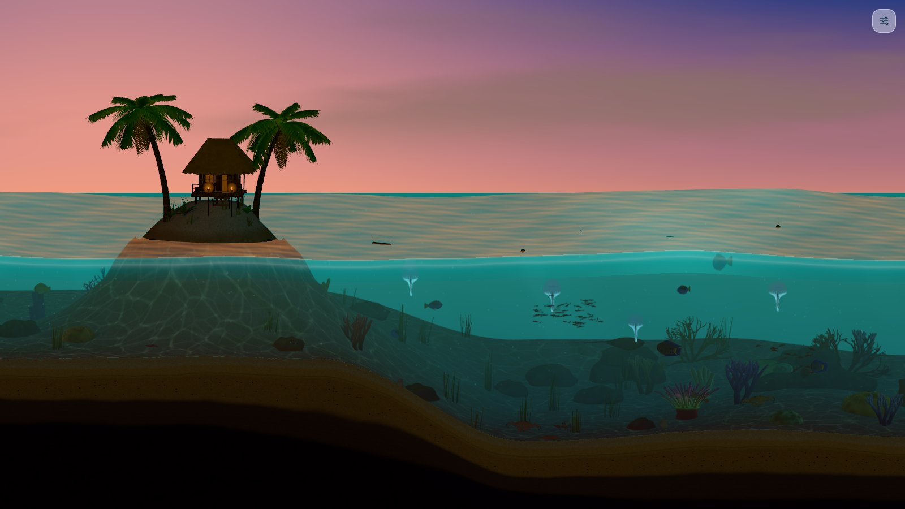

# Jelly Ocean Diorama

**Version 1.0** — first public release.

**Use it three ways:** as an interactive **desktop wallpaper** (Lively Wallpaper), as a
**desktop app** that opens in its own window from a shortcut, or in any browser.

An interactive 2.5D ocean cross-section rendered with Three.js: translucent "jelly / resin"
water with a rounded edge, a tiny tropical island with a Hawaiian-style hut and two palms,
layered seabed strata, a reef, and a small ecosystem of autonomous creatures. It is built
first as a browser app and packaged as a **Windows interactive wallpaper for Lively Wallpaper**.

Everything — models, textures, animation — is generated procedurally in code (see
[ASSETS.md](ASSETS.md)); there are no binary assets to download.

## Preview


| Dusk: lit hut, glowing jellyfish | Top View: the whole reef for editing | Ocean Studio panel |
|:---:|:---:|:---:|
|  |  |  |

*Real in-app captures (1600×900). Every frame is rendered live — the water, fish and plants keep moving.*

## Quick start

Requirements: Node.js 18+ (tested with Node 22) and a browser with WebGL2.

```bash
npm install
```

```bash
npm run dev
```

Open http://127.0.0.1:5173.

| Command | What it does |
|---|---|
| `npm run dev` | Vite dev server with hot reload |
| `npm run build` | Type-check + production build into `dist/` |
| `npm run preview` | Serve the production build |
| `npm run package:desktop` | Lively package + desktop app package → `dist-desktop/`, `JellyOcean-Desktop.zip` |
| `npm test` | Type-check + unit tests (Vitest): water sim stability, sediment rules, undo, crab shoreline, save migration, messages, coconut timer |
| `npm run typecheck` | TypeScript only |
| `npm run package:lively` | Single-file wallpaper build in `dist-lively/` + `JellyOcean-Lively.zip` |

URL flags: `?mode=ambient` / `?mode=play`, `?wallpaper=1` (host mode, starts in Ambient),
`?time=14.5` (fixed time of day), `?view=top`, `?panel=0` / `?panel=1`, `?tab=nature` — handy for
screenshots and shared links (the README previews were captured with these).

## Two views, one 3D world

Coordinates: **X** = left/right, **Y** = height, **Z** = depth into the ocean (front glass at
z = 6, far side at z = −13). Terrain is a heightfield H(x, z) = H_base + H_sand and the water
surface is a heightfield W(x, z, t), so every system works in real 3D.

* **Front View** — the wallpaper composition: side cross-section with a slight downward tilt.
  Tools that need a depth use the **Depth (Z)** slider (mouse wheel), shown as a ring on the
  seabed at that depth.
* **Top View** — press **V** (or the view button in the panel header): the camera rotates up
  to look straight down onto the x–z plane. Clicks pick an exact X–Z spot; objects drag freely
  in X and Z. Switching never rebuilds anything — sand, objects and creatures stay put.

## Ocean life, discovery & mini games

A peaceful ocean that rewards curiosity. Nothing new pops up, plays sounds or starts by itself.

* **Deep world** — the real 3D world reaches from the front glass (z = 6) to z = −13. Water volume, seabed heightfield, wave simulation grid, creature roaming, object
  placement, sand editing and picking all use the new range. Top View frames the whole depth;
  Front View keeps its composition (the front cut is unchanged, the camera tilt went from 9.5°
  to 7.2° so sky / sea / seabed proportions stay the same). The new back region is deliberately
  sparse: a few outcrops, seagrass, a sea fan, corals and a second cave.
* **Ocean Mail** — every 45–120 minutes of *active* time (Rare / Normal / Often) a corked glass
  bottle with a rolled note drifts in from the left, riding the waves, wind and currents and never
  crossing land. Click it: the parchment note unrolls with an **ocean fact**, a **fortune** or a
  **gentle thought** (24 + 30 + 20 hand-written bilingual entries in `src/content/messages.ts`;
  recently seen ones are skipped). **中文 / EN** switches the note in place — same message.
  Close it and the bottle sinks away; ignore it and it drifts off. At most one bottle at a time.
* **Magnifier** (Interact → Magnifier, key **8**) — a live 1.5× / 2× / 3× lens that follows the
  pointer; click to **pin** it (it keeps rendering live), click again to unpin. It is a real second
  render through a narrowed camera, so details are sharp and exactly under the pointer.
* **Island Life — coconuts** (Nature → Island Life) — each palm grows coconuts on a real-time
  timer (30 m / 1 h / 2 h / **3 h** / 6 h, up to 3–5 per palm). Time passed while the wallpaper
  was closed counts (capped, no replayed animations). Click a ripe coconut to pick it or click a
  palm to shake it: coconuts fall, bounce and roll down the beach, splash, bob on the waves and
  later sink away. A countdown shows when the next one ripens.
* **Ocean Surprises** (World → Preferences) — roughly every 15–40 active minutes one small event:
  a starfish surfaces from the sand, a visiting school of fusiliers passes through, a crab carries
  a shell somewhere, a palm drops a dry frond (it lands on the sand or floats), or a shell washes
  up at the island. At most one at a time; everything they create is temporary.
* **Mini Activities** (Interact → Mini Activities; never auto-start, **Esc** exits)
  * **Stone Skipping** — press, pull back and release (slingshot). Front View: drag left/right =
    power and direction, drag down = launch angle, wheel turns the throw into / out of the scene;
    Top View: drag on the water = heading, wheel = angle. A dotted arc previews the throw. Flat,
    fast throws skip (each touch is a real wave in the shared surface, strong hits scatter fish);
    steep or slow ones plunge. Skip counter and personal best.
  * **Octopus Hide & Seek** — the real octopus crawls off to hide (cave, beside a rock, among
    corals or seagrass, or half-buried in sand), tucks in and camouflages toward that spot, and
    now and then moves an eye or arm tip. Click where you think it is; up to three hints (area
    ring → bubbles → a brief glimpse); the magnifier can be toggled in the game bar. Misses cost
    nothing. If the ocean has no octopus, one is borrowed for the game and returned after.
* **Preferences** (World) — language 中文 / English (notes, game bar, island timer), Ocean Mail
  on/off + frequency, Ocean Surprises on/off + frequency. Lively gets matching properties.
* **Input priority** — UI → active mini game → magnifier / bottle / coconuts → current tool →
  ambient hover. One press goes to exactly one layer, so a throw never also drags water or sand,
  and Hide & Seek turns off the creature tooltip (no spoilers).

### Persistence

* Preferences and slow real-time state (language, mail / surprise settings and countdowns,
  coconut timestamps, personal bests) are saved automatically in `localStorage`
  (`jelly-ocean-v3`) — independent of the Save World slot, so timers survive restarts.
* **Save World / Export** writes save schema **v3**: the sand grid stores its own bounds and the
  V3 data under `extras`. **v2 saves still load**: their sand grid (z −6…6) is resampled by world
  coordinates onto the deeper grid, so piles, islands and objects stay exactly where they were.
* Temporary things (ripples, spray, an event in progress, a floating bottle, fallen coconuts,
  thrown stones) are never saved.

### Dev helpers (not in the UI)

In the browser console: `__jelly.mail.spawnTest()` (a bottle near the left edge),
`__jelly.events.trigger('starfish' | 'school' | 'crabShell' | 'palmLeaf' | 'shellAshore')`,
`__jelly.games.start('skip' | 'hide')`.

## Living world

**Panel tabs:** Interact · Create · Life · Nature · World.

* **Nature** — *Time of day* (Manual / accelerated Day cycle / follow the PC clock; **N** toggles
  day ↔ night), *Sea level* (Manual or automatic *Tide cycle*), *Wind*, *Rain*, water colour.
  Night brings stars, moonlight, a lit hut (windows, torches, warm light on the sand), softly
  glowing jellyfish and bioluminescent plankton: sweeping the pointer through the water, painting
  currents, fast fish and raindrops leave short glowing trails.
* **Tide** — one sea level drives the water, wet/dry sand shading, creatures and tools. At low
  tide beaches and stamped sand bars surface and crabs forage along the tide line; at high tide
  they flood again.
* **Water, three scales on one height field W(x, z, t)** — *micro ripples* (pointer sweeps,
  raindrops, bubble pops, food), *jelly drag* (bigger lift / press with spring recovery, hard
  limits), *swell & waves* (long swell even when calm, stronger with wind). Floating coconuts,
  a palm leaflet, a flower and driftwood ride that surface, so Front and Top View show exactly
  the same deformation.
* **Life** — population sliders for every species (new arrivals swim in from the edge, removed
  ones swim away) plus stingray / octopus toggles. Hover any creature to see what it is doing.
* **Create → Place** — anemones, cave rocks, empty shells, corals, sea fans, seagrass, rocks.
  They are habitats, not just decor: clownfish may move into a new anemone, the octopus explores
  and adopts new caves, hermit crabs inspect empty shells and swap (leaving their old shell
  behind). **Objects → Remove** deletes objects (undoable).
* **Personalities** — fish get hungry over time (they notice food sooner), rest beside the reef
  (mostly at night), get curious (inspect new objects or swim up to the front glass) and get
  startled; crabs dig and visit the shoreline; the octopus peeks, hides, explores and inks rarely.
* **Models** — rebuilt crab (toothed, spotted carapace, 3-segment legs, toothed chelae,
  antennae), octopus (papillae skin, golden bar-pupil eyes, arm web, siphon, visible suckers),
  stingray (rounded disc, raised eyes and spiracles, pelvic fins, banded tail with sting) and the
  new hermit crab.

## Controls — Ocean Studio panel

Right-side glass panel with three tabs (collapse with the arrow or **H**). Each tool shows
only its own properties.

| Tab | Tool | Key | What it does |
|---|---|---|---|
| Interact | Water | 1 | Hover ripples · drag lifts / presses the surface (Front) or ploughs waves (Top) · click a creature for a species-specific reaction |
| Interact | Current | 2 | Drag through the water to paint a current; a loop makes a swirl. Fish shift course, jellyfish drift, particles, sand, food, bubbles and seagrass follow. Strength / size / depth |
| Interact | Feed | 3 | Click over the water; pellet count and depth are adjustable |
| Interact | Bubbles | 4 | Hold on the seabed for a rising stream that pops into ripples |
| Create | Sand → Add | 5 | Hold to pour; **Flow rate** sets how much, **Brush size** the spread |
| Create | Sand → Erase | 5 | Removes only added sand / stamped islands — the original seabed is protected |
| Create | Sand → Smooth | 5 | Softens peaks and fills small hollows |
| Create | Sand → Island | 5 | Click to place a sand bar that rises above the water (compacted: it doesn't slump; erase or smooth it like other sand) |
| Create | Objects | 6 | Drag corals, rocks, shells, seagrass; wheel while dragging = depth in Front View; invalid drops snap back |

Creature reactions (Water tool click): octopus peeks out when gently disturbed, hides when
disturbed repeatedly and only sometimes inks; jellyfish glow and pulse (they also glow softly
when the pointer comes near); crabs raise claws and scuttle away; the stingray banks off; fish dart.

**World tab:** water colour presets + custom, wind 0–100, Front / Top view, Play / Ambient,
**Save / Load World** (stored locally and restored automatically on the next start — added sand,
islands and object placement; creatures re-initialise), Export / Import as a JSON file, and
Reset (click twice).

Shortcuts: **1–7** tools, **8** magnifier, **Esc** leaves a mini game / closes a note, **Ctrl+Z** undo, **Ctrl+Y / Ctrl+Shift+Z** redo, **V** view, **N** day/night, **[ ]** brush size,
wheel = depth (Shift+wheel = size), **A** ambient, **H** panel, **Esc** back to Water.

## Architecture

```
src/
  main.ts                      bootstrap + WebGL2 check
  config.ts                    all tunable parameters (world, water, sand, feed, creatures, perf)
  core/
    App.ts                     SceneManager: systems, main loop, FPS cap, adaptive resolution, reset/undo
    CameraManager.ts           Front / Top dual view in one orthographic camera, animated switch, pointer→world
    RenderPipeline.ts          3-pass pipeline (scene → HDR target, composite + depth, water)
    EnvironmentController.ts   wind smoothing, water look transitions
  water/
    WaterSurfaceSimulation.ts  damped 2D wave equation heightfield (interaction, island walls)
    WaveField.ts               analytic wind waves shared by CPU and GLSL
    OceanRenderer.ts           jelly water mesh + refraction/absorption/fresnel shader, god rays
    WaterColor.ts              water looks (scatter colours + Beer–Lambert absorption)
  world/
    TerrainSystem.ts           base terrain + removable sand layer (+ compacted island part), add / erase /
                               smooth / island stamp, angle-of-repose sliding, any-angle raycast, strata cut
    FlowField.ts               painted currents sampled by creatures, particles and plant shaders
    SedimentSimulation.ts      pooled sand grains → sediment, dust feedback
    Island.ts                  hut, palms, shrubs, grass (procedural)
    Reef.ts / coralFactory.ts  reef props, selectable registry, obstacles, hiding spots
    Sky.ts, Lighting.ts, Particles.ts (bubbles, marine snow)
  creatures/
    CreatureManager.ts         owns creatures, routes events (food, sand, ripples, moved objects)
    FishSystem.ts              boids schools + solitary tropical fish, steering FSM, instancing
    fishSpecies.ts             6 procedural fish species (lofted body, fins, painted textures)
    FoodSystem.ts, Stingray.ts, Jellyfish.ts, Crab.ts, Octopus.ts
  interaction/
    ToolStateManager.ts, InteractionManager.ts, SelectionManager.ts, HistoryManager.ts, GroundMarker.ts
  ui/        UIController.ts, icons.ts, styles.css   (lightweight DOM, no framework)
  platform/  WallpaperAdapter.ts (Lively / Wallpaper Engine), Settings.ts, WorldStore.ts (save / load / export)
```

### Rendering the jelly water
Transparent water is the classic sorting problem, so the water is not alpha-blended at all:

1. The whole world (opaque + transparent creatures) renders into an HDR, MSAA render target
   with a depth texture.
2. A fullscreen pass composites it to the canvas and restores its depth buffer.
3. The water mesh renders last with depth testing and computes its own final colour from the
   scene colour + depth: thickness = distance from the water surface to whatever is behind it,
   then Beer–Lambert absorption, depth-dependent in-scatter tint, screen-space refraction
   (rejecting samples in front of the water), fresnel sky reflection, sun specular and a soft
   inner "resin" rim. The water geometry has a rounded front bevel; the upper front face follows
   the surface height with falloff, so the block wobbles like jelly.

### Physics
* **Water:** 256×24 heightfield, damped wave equation with spring restoring force, reflective
  walls at the slab edges and around the island, soft amplitude clamp (no tearing). Analytic wind
  waves are added on top; phases are integrated so wind changes never jump.
* **Sand:** particles (gravity, water drag to terminal velocity, turbulent dispersion, sphere
  collisions with rocks/corals) settle into a sediment height grid; an angle-of-repose pass
  makes steep piles slump. Base terrain is a separate, indestructible array.
* **Creatures:** steering behaviours + finite state machines (see below).

### Ecosystem
* **Silverside school** (44) and **cardinalfish school** (16): boids (separation, alignment,
  cohesion) chasing a wandering school goal that sometimes leaves the screen and returns.
* **Clownfish** stay around the anemone; **blue tangs**, **butterflyfish** and **angelfish**
  wander their own zones at different speeds. Food reaction is species-specific (schools react
  fast, angelfish slowly), with detection radius, reaction delay, arrive-steering, eating and
  a satiation timer. All fish avoid terrain, the island, rocks/corals, big creatures, the surface
  and each other, with turn-rate limits.
* **Stingray:** slow gliding between waypoints with travelling wing undulation, banking, exits.
* **Jellyfish:** pulse-driven (fast contraction, slow relaxation), drift with the current,
  never chase food, keep clear of the seabed and surface.
* **Crabs:** sideways walk with leg gait, idle claw picking, forage settled food, flee/alert when
  sand lands or objects move nearby.
* **Octopus:** hidden in den / coral → peek → crawl ↔ explore → buried in sand (camouflage);
  retreats with an ink puff when disturbed, and relocates when its coral is moved.

### Performance
* Instanced fish, food and sand; pooled particles with hard caps (food 90, sand 1800, bubbles 260).
* Hut geometry is static-batched (one draw call per material).
* FPS cap (60 active, 30 ambient), adaptive pixel ratio (0.6–1.5) driven by measured frame
  time, lower resolution & reduced particles in Ambient, shadow map refreshed every 3rd frame in
  Ambient, rendering fully stops when the page is hidden or the wallpaper host pauses it.
* Measured on the development machine at 1280×720: ~1.7 ms CPU simulation + ~5.5 ms render per
  frame. Numbers vary by GPU; treat them as indicative, not a guarantee.

## Desktop app (shortcut, Windows)

Opens Jelly Ocean in its own window (Microsoft Edge app mode — no tabs or address bar; Edge
ships with Windows 10 / 11). Works fully offline.

1. Download `JellyOcean-Desktop.zip` from the **Releases** page (or build it with
   `npm run package:desktop`, output in `dist-desktop/`).
2. Unzip it to a permanent folder, then double-click **Create Desktop Shortcut.cmd** once.
3. Open **Jelly Ocean** from the desktop or the Start menu. **F11** toggles full screen.

The shortcut points at that folder (`index.html` + `JellyOcean.ico`). Without Edge it falls back
to opening the page in the default browser; double-clicking `index.html` also works. Saves and
timers live in that browser's local storage (separate from the Lively wallpaper's storage).

## Desktop wallpaper (Lively Wallpaper, Windows)

1. Install [Lively Wallpaper](https://www.rocksdanister.com/lively/) (Microsoft Store or GitHub).
2. Get the package: download `JellyOcean-Lively.zip` from this repository's **Releases** page, or
   build it yourself:
   ```bash
   npm run package:lively
   ```
3. In Lively: **+ Add Wallpaper** → choose `JellyOcean-Lively.zip` (or the
   `dist-lively/index.html` file).
4. Customise via Lively's wallpaper settings (gear icon): Play mode, wind, time of day, rain,
   tide, water colour, custom colour, language, Ocean Mail, Ocean Surprises (+ frequency),
   quality and Reset world — defined in `lively/LivelyProperties.json`.
5. For interaction, enable **Lively Settings → Wallpaper → Input → Mouse** ("Wallpaper Input").
   Lively only forwards the mouse when the pointer is over empty desktop, and drags are not
   guaranteed, so wallpaper sessions start in **Ambient** mode (hover ripples + gentle click
   splashes). Tick "Interactive Play mode" in the wallpaper settings to show the full panel.
6. Lively pauses the wallpaper when a fullscreen app is active
   (`livelyWallpaperPlaybackChanged`); the app then stops rendering entirely.

Why a special package? Lively loads wallpapers from `file://`, where ES-module scripts are blocked,
so `package:lively` builds a classic IIFE bundle and inlines JS + CSS into a single `index.html`.

Wallpaper Engine (web wallpaper) is also supported through `window.wallpaperPropertyListener`
with the same property names, but it is not packaged/tested here.

## Configuration

Key parameters live in [src/config.ts](src/config.ts): world bounds, camera tilt and framing,
island shape, water simulation constants (wave speed, damping, drag stiffness, max displacement,
refraction), sand (spawn rate, grain volume, repose slope, brush size, caps), feeding (pellets,
sink speed), creature counts and swim bounds, performance limits. Species behaviour (speed,
detection radius, reaction delay, zones) is in `BEHAVIOR` in `src/creatures/FishSystem.ts`.
User settings (water look, wind, mode, panel state) persist in `localStorage`.

## Implemented

- [x] True 3D scene, fixed orthographic camera with 9° tilt, 16:9 / 16:10 / 21:9 / narrow framing
- [x] Jelly water: thickness, rounded bevel, refraction, absorption, depth tint, fresnel, specular, god rays, caustics
- [x] Layered seabed cross-section, gentle relief, pebbles/shell hash, small left-of-centre island
- [x] Hut (deck, stilts, planks, door, window with shutter, 3-tier thatch, fringe, lantern, surfboard), two palms, shrubs, grass
- [x] Reef: staghorn, brain, sea fan, tube sponges, plate, leather corals, anemone, rocks, scallop, conch, starfish, seagrass
- [x] Default / Feed / Sand (add/remove) / Select tools with pointer-state safety
- [x] Water colour presets + custom, wind 0–100 with smooth transitions
- [x] Undo (sand strokes, moves), Reset, Ambient / Play modes, persisted settings
- [x] 6 fish species, schools, stingray, 3 jellyfish, 2 crabs, octopus with FSMs and reactions
- [x] Lively packaging with properties, playback pause, wallpaper input caveats
- [x] Unit tests for the simulation core (12 tests: water stability, sediment rules, smooth, island stamp, top-down raycast, undo/redo)
- [x] true 3D depth (12-unit-deep slab), Front / Top dual camera, X–Z editing, Depth control
- [x] terrain editor (flow rate, brush size, erase, smooth, island stamp), Current Brush, Bubble tool
- [x] creature poke reactions, jellyfish hover glow, Ocean Studio tabbed panel, Redo, Save / Load / Export World
- [x] island rebuilt as a low sand bar on a shallow lagoon shelf; softer water top face with capillary ripples

## Known limitations / next steps

**Discovery features**
- The note, game bar, island timer and preferences are bilingual; the rest of the panel is
  still English (as scoped for this round).
- Ocean Mail and surprises count *active* simulation time, so a wallpaper that is paused most of
  the day sees them rarely. That is intentional (no backlog), but "45–120 min" means time the
  ocean was actually running.
- The magnifier re-renders the scene once more per frame while visible; its buffers are
  released a few seconds after it is put away.
- Stone skipping uses a compact skip rule (entry angle under ~29°, speed above 2, energy loss
  per touch) rather than a full stone spin / tilt model.
- In Front View, Hide & Seek keeps hiding places in front of z ≈ −6.5, because the far back is
  lost in the water haze from that angle; Top View uses the whole depth.
- From the default Front View the fronds cover some coconuts, so clicking the palm (shake) is the
  dependable way to harvest; clicking a visible coconut picks just that one.
- No sounds were added (the spec asks for no intrusive sounds; an ambient audio layer is still
  open).

**Core**

- Creature and prop models are procedural stand-ins of reasonable fidelity; the crab and
  octopus are the first candidates for authored GLB models (see ASSETS.md for the swap points).
- Fish swim deformation is not applied in the shadow pass (shadows use the rest pose).
- Sand piles are stored on a 0.17 × 0.2 unit grid; very fine sculpting is not possible.
- Water-surface interaction is limited to the slab's top layer — no 3D fluid volume.
- Lively interaction depends on the host forwarding mouse input; desktop icons capture clicks.
- Not yet done: Follow Creature camera, birds, audio, a free-rotating 3/4 view, Wallpaper Engine
  packaging, a Lively thumbnail.
- v1.2 art pass done for palms, hut, fish, corals/rocks/seagrass; crab, octopus and stingray are
  the remaining stand-ins — see ASSETS.md for swap points.
