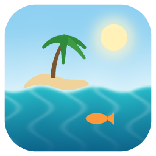
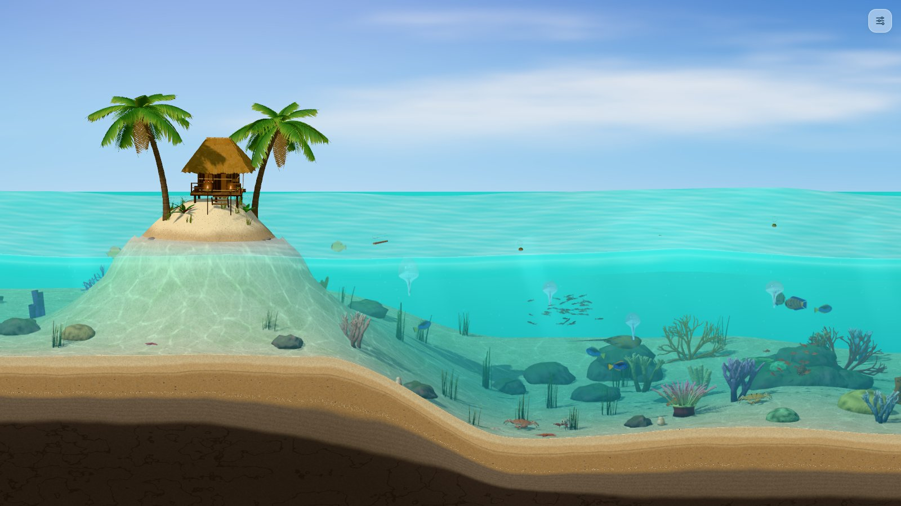
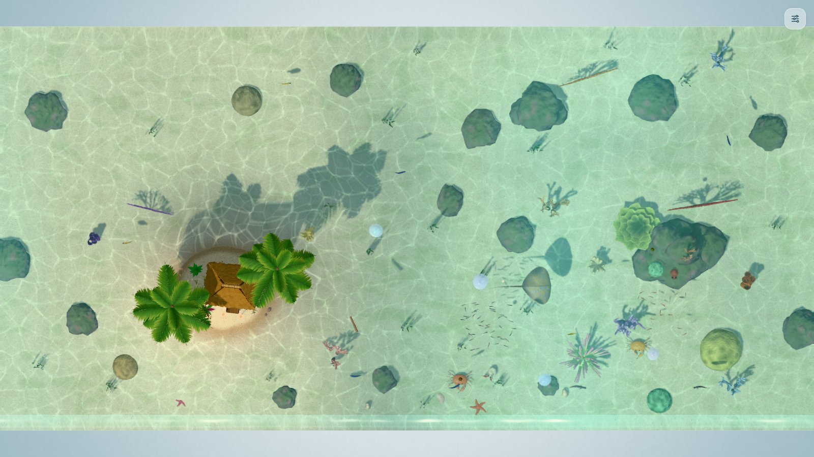
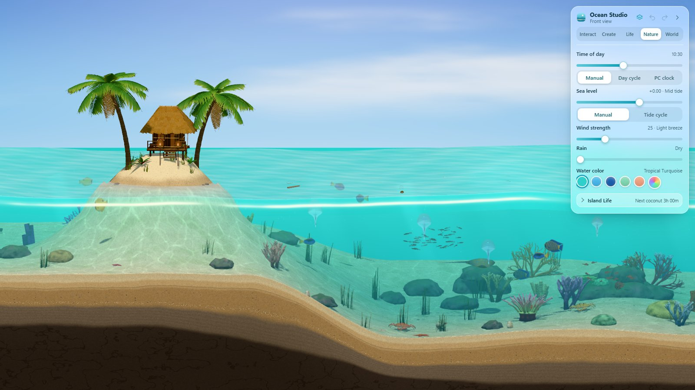

# Jelly Ocean Diorama

**Version 2.0** — the ocean grew into a small, bounded archipelago with
three camera views (Focus, Full, Top), keeps an **Ocean Journal**, and is now and then visited by
**rare visitors** you can sketch in a **Field Notebook** (see [Changelog](#changelog)).

**Use it three ways:** as an interactive **desktop wallpaper** (Lively Wallpaper), as a
**desktop app** that opens in its own window from a shortcut, or in any browser.

An interactive 2.5D ocean cross-section rendered with Three.js: translucent "jelly / resin"
water with a rounded edge, a tiny tropical island with a Hawaiian-style hut and two palms,
layered seabed strata, a reef, and a small ecosystem of autonomous creatures. It is built
first as a browser app and packaged as a **Windows interactive wallpaper for Lively Wallpaper**.

Everything — models, textures, animation — is generated procedurally in code (see
[ASSETS.md](ASSETS.md)); there are no binary assets to download.

## Preview



| Dusk: lit hut, glowing jellyfish | Top View: the whole reef for editing | Ocean Studio panel |
|:---:|:---:|:---:|
|  |  |  |

*Real in-app captures (1600×900). Every frame is rendered live — the water, fish and plants keep moving.*

## Quick start

Requirements: Node.js 18+ (tested with Node 22) and a browser with WebGL2.

```bash
npm install
```

```bash
npm run dev
```

Open http://127.0.0.1:5173.

| Command | What it does |
|---|---|
| `npm run dev` | Vite dev server with hot reload |
| `npm run build` | Type-check + production build into `dist/` |
| `npm run preview` | Serve the production build |
| `npm run package:desktop` | Lively package + desktop app package → `dist-desktop/`, `JellyOcean-Desktop.zip` |
| `npm run demo:video` | Renders the ~1-minute gameplay demo (1080p60 + 720p web version, synthesized music & sound effects) into `demo/` — needs Microsoft Edge, no other tools |
| `npm test` | Type-check + unit tests (Vitest): water sim stability, sediment rules, undo, crab shoreline, save migration, messages, coconut timer |
| `npm run typecheck` | TypeScript only |
| `npm run package:lively` | Single-file wallpaper build in `dist-lively/` + `JellyOcean-Lively.zip` |

URL flags: `?mode=ambient` / `?mode=play`, `?wallpaper=1` (host mode, starts in Ambient),
`?time=14.5` (fixed time of day), `?view=focus|full|top` (`front` = `focus`), `?x=-33` (Focus View
pan), `?panel=0` / `?panel=1`, `?tab=nature` — handy for screenshots (the README previews were
captured with these).

## A small archipelago, three views, one 3D world

Coordinates: **X** = left/right (−51 … 51), **Y** = height, **Z** = depth into the ocean (front
glass at z = 6, far side at z = −22.6). Terrain is a heightfield H(x, z) = H_base + H_sand and the
water surface is a heightfield W(x, z, t), so every system works in real 3D.

**The tray (V2 / P1).** The world is 1.7× wider and 1.5× deeper than v1 (about 2.5× the area) —
more room to create, but still a bounded "fish tank" with rounded jelly edges on every side, not
an endless map. From left to right:

| Area | What is there |
|---|---|
| West | the shallow **lagoon**: a **sand cay** with beach grass, shrubs, two palms and a driftwood log, ringed by a wide **tidal flat** that dries at low tide (it uses the normal tide); a cluster of **dark boulders** on a rocky reef flat right beside it; a low **granite-boulder island** at the back (big rounded boulders, two stacked into a small tor, palms rooted in the beach sand). Nine **patch reefs** and about twenty **seagrass meadows** cover the lagoon floor, with loners (urchins, clams, starfish, mushroom corals) on the open sand |
| Centre | the v1 diorama, unchanged: the main island with the hut and the two coconut palms, the reef, caves and meadows. Base terrain inside the v1 core (\|x\| < 23, z > −13) is exactly the same, so old saves land on the same ground |
| East | a **reef drop-off**: the seabed comes down in three soft rocky ledges into **deep water** (about −10.4). A few small, muted 3D sea rods, black coral, sponges and boulders on the upper ledges, thinning out and darkening with depth; the deep floor is almost empty and a little mysterious. With the calm far-back strip this is about a third of the tray |
| Back | a sparse row of tall silhouettes (sea fans, sea whips, pillar corals, rocks) along the far back of the whole tray, so Top / Full View aren't empty behind the reefs |

**Habitats.** Creatures pick their next spot from a habitat map (`src/world/Habitat.ts`): main
reef, lagoon patch reefs, seagrass, open lagoon, drop-off slope, deep water, open mid-water —
each species from the habitats it likes, in its own part of the water column. The v1 residents
keep their v1 home range (the Focus View is as lively as before), but blue tangs and
butterflyfish now and then visit the lagoon reefs and come back, the silverside school sometimes
crosses the whole tray, and the stingray glides out over the open sand instead of vanishing at
the frame edge.

**New residents** (Life → **Extra · new species**, each with its own slider):

| Where | Species | Habits |
|---|---|---|
| Lagoon | Sergeant majors (school, 16) | over the patch reefs and meadows |
| Lagoon | Parrotfish (3) | drift between all the reefs, low over the corals |
| Lagoon | Moon wrasses (4) | busy, close to the bottom |
| Lagoon | Lagoon crabs (3) | the sand around the cay; forage the waterline at low tide, never strand |
| Lagoon | Cleaner shrimp (5) | sit beside the patch reefs, wave their antennae, hop; a poke = tail flip |
| Lagoon | Sea urchins (5), sea cucumbers (3) | crawl slowly (urchins mostly at night) |
| Lagoon + slope | Garden eels (10, two colonies) | stand out of the sand leaning into the current; duck when fish, the ray or the pointer come close |
| Deep | Yellowtail snappers (school, 12) | along the drop-off |
| Deep | Barracudas (6) | hang almost still in the open deep water |
| Deep | Groupers (2) | heavy and patient, low by the ledges |

Rarer, special animals (lantern fish, mantas, turtles …) are left for the P3 visitors.
Creatures far outside the view think at a lower rate, so the extra life costs little.

**Three views** (buttons at the bottom-left, the World tab, or keys):

| View | What it is for | Controls |
|---|---|---|
| **Focus** (default, wallpaper default) | the v1 Front View scale and composition — a close, detailed slice | right / middle drag or **Space + drag** pans along the tray, **← →** keys, **double-click** centres a spot, click / drag on the **mini map**, optional **slow drift** |
| **Full** (**F**) | the whole tray, like a resin model on a wooden base | look and normal clicks; **double-click** a spot to glide into Focus View there |
| **Top** (**V**) | a map for editing | **wheel zooms** around the pointer (Shift + wheel = brush size), right / middle / Space drag pans, arrow keys; the X–Z editing tools work as before |

* Opening the app in Focus View gives **the v1 Front View framing**: the front waterline, the far
  horizon and the seabed strata sit exactly where they were. The deeper water uses a slightly
  lower tilt (≈4.8° instead of 7.2°, the same trick v1 used when the world first got deeper), so
  things in the middle of the tray — the hut, for example — sit about 1.5 % of the screen height
  lower than in v1.
* The **mini map** (bottom-left, Play mode only, can be hidden) shows land, shallows and deep
  water and the current frame. It has no markers or counters on purpose.
* **Slow drift** (off by default): when nobody has touched anything for a while, the Focus View
  glides very slowly along the islands and back.
* Tools that need a depth in Focus / Full View use the **Depth (Z)** slider (mouse wheel), shown
  as a ring on the seabed at that depth. Switching views never rebuilds anything.
* The camera view and pans are remembered between sessions. Lively gets **Camera view**
  (Focus / Full / Top) and **Slow camera drift** properties.

## Ocean Journal (V2 / P2)

A small diary beside the panel — the book button in the panel header or the bottom-left dock, or
**J**. Closed by default; nothing ever pops up, blinks or counts. New lines are simply there when
you open it. Two pages, both bilingual:

* **World Memory — what this sea has seen.** Written like a diary, grouped by day, one short line
  each: *"傍晚，一只漂流瓶漂过，又悄悄漂走了。"* It remembers bottles you opened *and* the ones that
  drifted past unopened, heavy rain, low tide drying the flats, coconuts that fell into the sea,
  Ocean Surprises, a hermit crab moving house, the octopus inking, mini activities, the first
  time you noticed a species (hover a creature for about a second, or click it), and a Reset.
  Repeats of the same small thing in a day merge into one line ("几颗椰子…"). It is append-only:
  **Undo never touches it, Reset World keeps it**, and it lives in its own storage
  (`jelly-ocean-journal-v1`), not in the Save World slot. Past 300 lines the oldest days fold into
  one-line summaries.
* **My Ocean — what you made here.** Islands you stamped, sand dunes you piled up, corals, rocks,
  shells and seagrass you placed, each with an automatic name from the moment it was made —
  *"雨天下午诞生的小沙洲"*, *"a staghorn coral planted under the moon"* — and where it is. Click a name
  to rename it (an empty name goes back to the automatic one). This list is **derived from the
  world as it is now**, not from a log: undo a stamp and the island leaves the list, redo it and
  it is back; erase a dune and it is gone; Reset empties it; loading a world shows that world's
  things. Shells a hermit crab leaves behind are the crab's, not yours.
* **Field Notebook — what you have seen with your own eyes** (V2 / P3, third tab). A page appears
  the first time you watch a species (hover ≈ 1 s or click — residents and visitors alike) or see
  a behaviour happen. Each page has a small pencil-and-wash sketch made from the live scene at
  that moment, the name in both languages, two or three plain lines of natural history, and when
  you first saw it. Pages are listed in the order you found them. **There is no total, no empty
  slot, no silhouette and no "x / y"** — the book only knows what you have seen, never what you
  haven't. Behaviours count only when they happen on screen, the window is visible and someone
  used the mouse or keyboard in the last three minutes (so a wallpaper left alone does not fill
  the book by itself): a hermit crab changing shells, the octopus inking or hiding in the sand, a
  crab picking up food, garden eels ducking, a turtle coming up for air, a manta somersault,
  dolphins leaping, a cuttlefish's passing colour bands, flying fish gliding. Sketches are small
  JPEGs (240×180) kept with the journal, not in the Save World slot.

## Rare visitors (V2 / P3)

Every so often something passes through that does not live here. Visits are **predictable rather
than random**: each visitor has habits, and the odds follow the time of day, the moon (the real
one, from today's date) and the wind. They never come in a crowd — at most one at a
time, with at least 20 minutes of *active* time between two visits — and nothing announces them.
On a typical afternoon that is roughly one visitor an hour.

| Visitor | When it tends to come | Stays | Where / what it does |
| --- | --- | --- | --- |
| Green sea turtle | any time, twice as likely 16:00–19:00 | 5–8 min | grazes the seagrass meadows, now and then rises for a breath |
| Manta ray | only at night, more around the full moon | 4–6 min | slow loops over the deep east, sometimes a somersault |
| Dolphins | by day; five times likelier in the half hour after strong wind | 2–3 min | a small pod crossing the back, leaping |
| Whale shark | any time, the rarest (mean ≈ 7 h of active time) | 3–3.5 min | one slow pass along the deep far back |
| Seahorse | by day | 20–40 min | holds on to a seagrass blade and shifts now and then |
| Cuttlefish | mostly at dusk (17:00–20:00) | 4–6 min | hovers over the reef, dark bands flowing over its skin |
| Moray eel | any time | 8–12 min | peeks out of a crevice between rocks, slowly "breathing" |
| Flying fish | only when the wind is above 50 | 1–1.3 min | glide over the waves in short flights |

* **You can't really miss one.** A visit you did not see is still written in World Memory
  (*"傍晚，一只绿海龟来过。沙滩上留下了一串爪印。"*), and some leave a trace on a beach — turtle
  tracks, a white cuttlebone — which fades over a few real hours (it survives a restart).
  A visit you did watch is remembered as seen.
* **World → Preferences → Rare visitors:** 关 Off / 少 Few (half as often) / 正常 Normal. Lively gets
  a matching **Rare visitors** property. Reset World ends a visit in progress and clears traces;
  World Memory keeps the lines, as with everything else.
* Visitors are ordinary scene objects: residents give them room, you can hover and click them,
  the Magnifier sees them. They are not saved with the world.

## Ocean life, discovery & mini games

A peaceful ocean that rewards curiosity. Nothing new pops up, plays sounds or starts by itself.

* **Deep world** (v1) — the real 3D world reaches from the front glass (z = 6) to z = −13 (V2: −22.6). Water volume, seabed heightfield, wave simulation grid, creature roaming, object
  placement, sand editing and picking all use the new range. Top View frames the whole depth;
  Front View keeps its composition (the front cut is unchanged, the camera tilt went from 9.5°
  to 7.2° so sky / sea / seabed proportions stay the same). The new back region is deliberately
  sparse: a few outcrops, seagrass, a sea fan, corals and a second cave.
* **Ocean Mail** — every 45–120 minutes of *active* time (Rare / Normal / Often) a corked glass
  bottle with a rolled note drifts in from the left, riding the waves, wind and currents and never
  crossing land. Click it: the parchment note unrolls with an **ocean fact**, a **fortune** or a
  **gentle thought** (24 + 30 + 20 hand-written bilingual entries in `src/content/messages.ts`;
  recently seen ones are skipped). **中文 / EN** switches the note in place — same message.
  Close it and the bottle sinks away; ignore it and it drifts off. At most one bottle at a time.
* **Magnifier** (Interact → Magnifier, key **8**) — a live 1.5× / 2× / 3× lens that follows the
  pointer; click to **pin** it (it keeps rendering live), click again to unpin. It is a real second
  render through a narrowed camera, so details are sharp and exactly under the pointer.
* **Island Life — coconuts** (Nature → Island Life) — each palm (V2: also the palms on the sand
  cay and the granite island) grows coconuts on a real-time
  timer (30 m / 1 h / 2 h / **3 h** / 6 h, up to 3–5 per palm). Time passed while the wallpaper
  was closed counts (capped, no replayed animations). Click a ripe coconut to pick it or click a
  palm to shake it: coconuts fall, bounce and roll down the beach, splash, bob on the waves and
  later sink away. A countdown shows when the next one ripens.
* **Ocean Surprises** (World → Preferences) — roughly every 15–40 active minutes one small event:
  a starfish surfaces from the sand, a visiting school of fusiliers passes through, a crab carries
  a shell somewhere, a palm drops a dry frond (it lands on the sand or floats), or a shell washes
  up at the island. At most one at a time; everything they create is temporary.
* **Mini Activities** (Interact → Mini Activities; never auto-start, **Esc** exits)
  * **Stone Skipping** — press, pull back and release (slingshot). Front View: drag left/right =
    power and direction, drag down = launch angle, wheel turns the throw into / out of the scene;
    Top View: drag on the water = heading, wheel = angle. A dotted arc previews the throw. Flat,
    fast throws skip (each touch is a real wave in the shared surface, strong hits scatter fish);
    steep or slow ones plunge. Skip counter and personal best.
  * **Octopus Hide & Seek** — the real octopus crawls off to hide (cave, beside a rock, among
    corals or seagrass, or half-buried in sand), tucks in and camouflages toward that spot, and
    now and then moves an eye or arm tip. Click where you think it is; up to three hints (area
    ring → bubbles → a brief glimpse); the magnifier can be toggled in the game bar. Misses cost
    nothing. If the ocean has no octopus, one is borrowed for the game and returned after.
* **Preferences** (World) — language 中文 / English (notes, game bar, island timer), Ocean Mail
  on/off + frequency, Ocean Surprises on/off + frequency, Rare visitors off / few / normal,
  Ambient sound on/off + volume. Lively gets matching properties.
* **Ambient sound** (off by default; the speaker button in the bottom-left dock or World →
  Preferences) — a soft, white-noise-like soundscape synthesised in Web Audio, no audio files:
  slow brown-noise swells that breathe with the waves, a hushed foam wash at each swell top, a
  warm low underwater bed, the faint crackle of snapping shrimp, plus wind and rain when the
  weather has them. It fades out and suspends whenever the ocean is paused or hidden.
* **Input priority** — UI → active mini game → magnifier / bottle / coconuts → current tool →
  ambient hover. One press goes to exactly one layer, so a throw never also drags water or sand,
  and Hide & Seek turns off the creature tooltip (no spoilers).

### Persistence

* Preferences and slow real-time state (language, mail / surprise settings and countdowns,
  coconut timestamps, personal bests) are saved automatically in `localStorage`
  (`jelly-ocean-v3`) — independent of the Save World slot, so timers survive restarts.
* **Save World / Export** writes save schema **v5** (V2 / P2: adds the My Ocean records — where,
  when and under what sky each island / dune was made — and birth data on placed objects; v4 and
  older saves get their stamped islands recovered from the compacted sand, named "from before").
  Since v4 the sand grid stores its own bounds, only the
  box of cells that hold sand is written (the bigger tray doesn't bloat the save), and the V3 data
  sits under `extras`. **v2 and v3 saves still load**: their sand grid is resampled by world
  coordinates onto the archipelago grid. The V2 grid keeps v1's spacing and lines up with v1 rows
  and columns exactly, so piles, islands and objects stay exactly where they were, unblurred.
* Camera view, pans, slow drift and the mini map switch are stored with the basic settings
  (`jelly-ocean-settings-v1`).
* Temporary things (ripples, spray, an event in progress, a floating bottle, fallen coconuts,
  thrown stones) are never saved.

### Dev helpers (not in the UI)

In the browser console: `__jelly.mail.spawnTest()` (a bottle near the left edge),
`__jelly.events.trigger('starfish' | 'school' | 'crabShell' | 'palmLeaf' | 'shellAshore')`,
`__jelly.games.start('skip' | 'hide')`, `__jelly.visitors.trigger('turtle' | 'manta' | 'dolphin' |
'whaleShark' | 'seahorse' | 'cuttlefish' | 'moray' | 'flyingFish')`, `__jelly.visitors.stop()`, `__jelly.creatures.fish.predation.trigger('strike' | 'ambush')`.

## Living world

**Panel tabs:** Interact · Create · Life · Nature · World.

* **Nature** — *Time of day* (Manual / accelerated Day cycle / follow the PC clock; **N** toggles
  day ↔ night), *Sea level* (Manual or automatic *Tide cycle*), *Wind*, *Rain*, water colour.
  Night brings stars, moonlight, a lit hut (windows, torches, warm light on the sand), softly
  glowing jellyfish and bioluminescent plankton: sweeping the pointer through the water, painting
  currents, fast fish and raindrops leave short glowing trails.
* **Tide** — one sea level drives the water, wet/dry sand shading, creatures and tools. At low
  tide beaches and stamped sand bars surface and crabs forage along the tide line; at high tide
  they flood again.
* **Water, three scales on one height field W(x, z, t)** — *micro ripples* (pointer sweeps,
  raindrops, bubble pops, food), *jelly drag* (bigger lift / press with spring recovery, hard
  limits), *swell & waves* (long swell even when calm, stronger with wind). Floating coconuts,
  a palm leaflet, a flower and driftwood ride that surface, so Front and Top View show exactly
  the same deformation.
* **Life** — population sliders for every species (new arrivals swim in from the edge, removed
  ones swim away) plus stingray / octopus toggles. Hover any creature to see what it is doing.
* **Create → Place** — anemones, cave rocks, empty shells, corals, sea fans, seagrass, rocks.
  They are habitats, not just decor: clownfish may move into a new anemone, the octopus explores
  and adopts new caves, hermit crabs inspect empty shells and swap (leaving their old shell
  behind). **Objects → Remove** deletes objects (undoable).
* **Personalities** — fish get hungry over time (they notice food sooner), rest beside the reef
  (mostly at night), get curious (inspect new objects or swim up to the front glass) and get
  startled; crabs dig and visit the shoreline; the octopus peeks, hides, explores and inks rarely.
* **Models** — rebuilt crab (toothed, spotted carapace, 3-segment legs, toothed chelae,
  antennae), octopus (papillae skin, golden bar-pupil eyes, arm web, siphon, visible suckers),
  stingray (rounded disc, raised eyes and spiracles, pelvic fins, banded tail with sting) and the
  new hermit crab.

## Controls — Ocean Studio panel

**One place for every control** (top-right). Its top bar is always there: Full / Focus / Top
view, slow drift, mini map, ambient sound, Ocean Journal, Undo / Redo and Settings (the gear opens
World → Settings). The arrow (or **H**) folds the body below it — the Interact / Create / Life /
Nature / World tabs — so a collapsed studio is just that small bar. The mini map sits bottom-left
and the Ocean Journal opens on the left, so nothing covers the panel. Each tool shows only its
own properties.

**One language.** World → Settings → Language switches the *whole* interface (panel, hints,
toasts, creature tooltips, journal, notes, games) between 中文 and English at once.

**First visit.** The empty tray fills with water, the fish swim in from the edges, and four short
cards show what you can do; then they fade away for good (Settings → *Show the welcome again*
replays it). Wallpaper / ambient starts skip it.

| Tab | Tool | Key | What it does |
|---|---|---|---|
| Interact | Water | 1 | Hover ripples · drag lifts / presses the surface (Front) or ploughs waves (Top) · click a creature for a species-specific reaction |
| Interact | Current | 2 | Drag through the water to paint a current; a loop makes a swirl. Soft white streaks show where the water flows; fish shift course, jellyfish drift, particles, sand, food, bubbles and seagrass bend along the whole stroke. Strength / size / depth |
| Interact | Feed | 3 | Click over the water; pellet count and depth are adjustable |
| Interact | Bubbles | 4 | Hold on the seabed for a rising stream that pops into ripples |
| Create | Sand → Add | 5 | Hold to pour; **Flow rate** sets how much, **Brush size** the spread |
| Create | Sand → Erase | 5 | Removes only added sand / stamped islands — the original seabed is protected |
| Create | Sand → Smooth | 5 | Softens peaks and fills small hollows |
| Create | Sand → Island | 5 | Click to raise a small sand island: a flat beach top and a gently flaring underwater slope, like a real sand bar (compacted: it doesn't slump; erase or smooth it like other sand) |
| Create | Objects | 6 | Drag corals, rocks, shells, seagrass; wheel while dragging = depth in Front View; invalid drops snap back |

**Meeting the creatures** (Water tool) — three gentle levels, always short, always back to normal:
* *Rest the pointer* on a creature (≈ ⅓ s, once in a while per animal): curious reef fish (tangs,
  butterflyfish, angelfish, parrotfish, wrasses, groupers) come closer and turn to look;
  clownfish and sergeant majors dart at the pointer to defend their patch; crabs raise their claws
  in a threat display; the octopus flushes a wave of colour; garden eels nearest to you duck one
  after another; the stingray veers off; a moray slides back into its crevice; the turtle turns
  its head toward you; a seahorse turns to face you.
* *Click*: the fish around burst away and regroup (a school balls up for a moment); clownfish dive
  into their anemone; a parrotfish crunches coral into a puff of white sand; crabs scuttle off —
  or, under water, dig in until only their eyes show; hermit crabs hide in their shell; the octopus
  peeks, hides or inks; the stingray darts off in a cloud of sand; urchins raise their spines and
  sea cucumbers pull themselves short; shrimps tail-flip; a moray gapes, then retreats; a seahorse
  curls up.
* *Press and hold*: a fish stops and hovers in front of you; the octopus slowly reaches one arm
  toward the pointer; a jellyfish can be guided gently along.

**World tab:** Play / Ambient, Settings (language, Ocean Mail, surprises, rare visitors, ambient
sound, quality Auto / High / Battery saver, replay the welcome),
**Save / Load World** (stored locally and restored automatically on the next start — added sand,
islands and object placement; creatures re-initialise), Export / Import as a JSON file, and
Reset (click twice).

Shortcuts: **J** Ocean Journal, **1–7** tools, **8** magnifier, **Esc** leaves a mini game / closes a note, **Ctrl+Z** undo, **Ctrl+Y / Ctrl+Shift+Z** redo, **V** Focus ↔ Top, **F** Full ↔ Focus, **← → (↑ ↓)** pan,
right / middle drag or **Space + drag** pan, double-click = centre there, **N** day/night, **[ ]** brush size,
wheel = depth (Top View: zoom; Shift+wheel = size), **A** ambient, **H** panel, **Esc** back to Water.

## Architecture

```
src/
  main.ts                      bootstrap + WebGL2 check
  config.ts                    all tunable parameters (world, water, sand, feed, creatures, perf)
  core/
    App.ts                     SceneManager: systems, main loop, FPS cap, adaptive resolution, reset/undo
    CameraManager.ts           Focus / Full / Top poses in one orthographic camera, eased transitions, pans, zoom, pointer→world
    RenderPipeline.ts          3-pass pipeline (scene → HDR target, composite + depth, water)
    EnvironmentController.ts   wind smoothing, water look transitions
  water/
    WaterSurfaceSimulation.ts  damped 2D wave equation heightfield (interaction, island walls)
    WaveField.ts               analytic wind waves shared by CPU and GLSL
    OceanRenderer.ts           jelly water mesh + refraction/absorption/fresnel shader, god rays
    WaterColor.ts              water looks (scatter colours + Beer–Lambert absorption)
  world/
    TerrainSystem.ts           base terrain + removable sand layer (+ compacted island part), add / erase /
                               smooth / island stamp, angle-of-repose sliding, any-angle raycast, strata cut
    FlowField.ts               painted currents sampled by creatures, particles and plant shaders
    SedimentSimulation.ts      pooled sand grains → sediment, dust feedback
    Island.ts                  hut, palms, shrubs, grass (procedural)
    Archipelago.ts             V2 sand cay + tidal flat, boulder cluster, granite island, east drop-off (terrain + dressing)
    Plinth.ts                  the wooden display base seen in Full View
    Reef.ts / coralFactory.ts  reef props, selectable registry, obstacles, hiding spots
    Sky.ts, Lighting.ts, Particles.ts (bubbles, marine snow)
  creatures/
    CreatureManager.ts         owns creatures, routes events (food, sand, ripples, moved objects)
    FishSystem.ts              boids schools + solitary tropical fish, steering FSM, instancing
    fishSpecies.ts             6 procedural fish species (lofted body, fins, painted textures)
    FoodSystem.ts, Stingray.ts, Jellyfish.ts, Crab.ts, Octopus.ts
  interaction/
    ToolStateManager.ts, InteractionManager.ts, SelectionManager.ts, HistoryManager.ts, GroundMarker.ts
  ui/        UIController.ts, icons.ts, styles.css   (lightweight DOM, no framework)
  features/  V3 / V2 feature modules (… CameraNav.ts pan / zoom / drift, MiniMap.ts views dock + map,
             OceanJournal.ts diary UI, WorldMemory.ts, Creations.ts, RareVisitors.ts scheduling + traces,
             FieldNotebook.ts observation + sketches; creatures/Visitors.ts the eight visitors)
  content/   messages.ts (Ocean Mail), journal.ts (bilingual diary lines and automatic names),
             notebook.ts (bilingual Field Notebook pages)
  platform/  WallpaperAdapter.ts (Lively / Wallpaper Engine), Settings.ts, WorldStore.ts (save / load / export)
```

### Rendering the jelly water
Transparent water is the classic sorting problem, so the water is not alpha-blended at all:

1. The whole world (opaque + transparent creatures) renders into an HDR, MSAA render target
   with a depth texture.
2. A fullscreen pass composites it to the canvas and restores its depth buffer.
3. The water mesh renders last with depth testing and computes its own final colour from the
   scene colour + depth: thickness = distance from the water surface to whatever is behind it,
   then Beer–Lambert absorption, depth-dependent in-scatter tint, screen-space refraction
   (rejecting samples in front of the water), fresnel sky reflection, sun specular and a soft
   inner "resin" rim. The water geometry has a rounded front bevel; the upper front face follows
   the surface height with falloff, so the block wobbles like jelly.

### Physics
* **Water:** 435×123 heightfield (v1 cell size), damped wave equation with spring restoring force,
  reflective walls at the slab edges and around islands, soft amplitude clamp (no tearing).
  Analytic wind waves are added on top; phases are integrated so wind changes never jump.
  V2: the grid is split into 16×16 tiles; only tiles in or near the view that actually move are
  simulated (calm tiles sleep, a disturbance or an active neighbour wakes them), so the cost
  follows what you see, not the size of the tray.
* **Sand:** particles (gravity, water drag to terminal velocity, turbulent dispersion, sphere
  collisions with rocks/corals) settle into a sediment height grid; an angle-of-repose pass
  makes steep piles slump. Base terrain is a separate, indestructible array.
* **Creatures:** steering behaviours + finite state machines (see below).

### Ecosystem
* **Silverside school** (44) and **cardinalfish school** (16): boids (separation, alignment,
  cohesion) chasing a wandering school goal that sometimes leaves the screen and returns.
* **Clownfish** stay around the anemone; **blue tangs**, **butterflyfish** and **angelfish**
  wander their own zones at different speeds. Food reaction is species-specific (schools react
  fast, angelfish slowly), with detection radius, reaction delay, arrive-steering, eating and
  a satiation timer. All fish avoid terrain, the island, rocks/corals, big creatures, the surface
  and each other, with turn-rate limits.
* **Stingray:** slow gliding between waypoints with travelling wing undulation, banking, exits.
* **Jellyfish:** pulse-driven (fast contraction, slow relaxation), drift with the current,
  never chase food, keep clear of the seabed and surface; if an island is raised under one it
  slides down the slope to deeper water.
* **Crabs:** sideways walk with leg gait, idle claw picking, forage settled food, flee/alert when
  sand lands or objects move nearby.
* **Octopus:** hidden in den / coral → peek → crawl ↔ explore → buried in sand (camouflage);
  retreats with an ink puff when disturbed, and relocates when its coral is moved.
* **Predators and prey** (gentle, mostly failing — as in the sea):
  * *Barracuda strike* — every few minutes (more often at dusk and dawn) a barracuda leaves its
    group, cruises up to a school (silversides, cardinals, sergeant majors or snappers, preferring
    one in view), stalks it while the school balls up and slows down, then dashes straight
    through; the school bursts apart around it ("flash expansion") and regroups.
  * *Grouper ambush* — a grouper settles beside a rock or coral head and waits almost motionless;
    when a small fish passes in front at its depth it lunges, the suction lifts a puff of sand and
    the fish around scatter.
  * About 1 strike in 5 and 1 lunge in 4 catches something. The fish is simply gone; a newcomer
    joins the population a minute or two later, so counts always return to the Life settings.
  * Both are Field Notebook behaviours (when someone is watching).
* **Shallow water:** when the sea level or tide drops (or an island is raised), fish, the
  stingray and rare visitors head for deeper water instead of being pressed into the sand or
  left on dry land.

### Performance
* Instanced fish, food and sand; pooled particles with hard caps (food 90, sand 1800, bubbles 260).
* Hut geometry is static-batched (one draw call per material).
* **Even frame pacing:** the display's real refresh rate is measured and frames are drawn on an
  exact multiple of it (60 fps on a 120 Hz screen = every 2nd refresh, 30 fps in Ambient = every
  4th), so motion stays smooth instead of alternating 16.7 / 25 ms frames.
* **Automatic quality** (Settings → Quality: Auto) counts frames that miss their slot rather than
  averaging frame times (which hides judder). Too many misses → one step down a ladder that cuts
  anti-aliasing and shadow refreshes *before* it touches resolution (and never below 0.75 pixel
  ratio); steps back up only after a long clean stretch, waiting longer and longer after a failed
  try, so quality never bounces. *High* keeps full quality; *Battery saver* stays low. Ambient no
  longer lowers the resolution — it just draws 30 fps. The last good level is remembered.
* **F9** (or `?perf=1`) shows a small readout: fps, refresh rate, frame / simulation time, quality
  level, pixel ratio and missed frames — handy to check smoothness on a real machine.
* Rendering fully stops when the page is hidden or the wallpaper host pauses it.
* On laptops with two GPUs, Windows may run the browser on the integrated one: Settings → System
  → Display → Graphics → set Microsoft Edge / Lively to *High performance*.
* Measured on the development machine at 1280×720: ~1.7 ms CPU simulation + ~5.5 ms render per
  frame (v1). V2 / P1, Focus View, production build, same machine and browser: CPU step
  2.02 ms (v1) → 2.37 ms (V2, +17 %). Numbers vary by GPU; treat them as indicative.
* V2: the sun's shadow map follows the part of the tray in view (v1 sharpness in Focus View);
  particles, plankton and rain live in the view window; sand relaxation only sweeps the edited area.
* V2 / P3: a visitor adds well under 1 ms of CPU per frame (whale shark, the biggest: +0.2–0.5 ms
  median in headless Edge). Only the visitor in the water exists; its mesh is built on first use.
  A notebook sketch is one extra 240×180 render the first time something is observed; its buffers
  are released a few seconds later.

## Desktop app (shortcut, Windows)

Opens Jelly Ocean in its own window (Microsoft Edge app mode — no tabs or address bar; Edge
ships with Windows 10 / 11). Works fully offline.

1. Download `JellyOcean-Desktop.zip` from the **Releases** page (or build it with
   `npm run package:desktop`, output in `dist-desktop/`).
2. Unzip it to a permanent folder, then double-click **Create Desktop Shortcut.cmd** once.
3. Open **Jelly Ocean** from the desktop or the Start menu. **F11** toggles full screen.

The shortcut points at that folder (`index.html` + `JellyOcean.ico`). Without Edge it falls back
to opening the page in the default browser; double-clicking `index.html` also works. Saves and
timers live in that browser's local storage (separate from the Lively wallpaper's storage).

## Desktop wallpaper (Lively Wallpaper, Windows)

1. Install [Lively Wallpaper](https://www.rocksdanister.com/lively/) (Microsoft Store or GitHub).
2. Get the package: download `JellyOcean-Lively.zip` from this repository's **Releases** page, or
   build it yourself:
   ```bash
   npm run package:lively
   ```
3. In Lively: **+ Add Wallpaper** → choose `JellyOcean-Lively.zip` (or the
   `dist-lively/index.html` file).
4. Customise via Lively's wallpaper settings (gear icon): Play mode, camera view, slow camera drift, wind, time of day, rain,
   tide, water colour, custom colour, language, Ocean Mail, Ocean Surprises (+ frequency),
   Rare visitors, ambient sound (+ volume), quality and Reset world — defined in `lively/LivelyProperties.json`.
5. For interaction, enable **Lively Settings → Wallpaper → Input → Mouse** ("Wallpaper Input").
   Lively only forwards the mouse when the pointer is over empty desktop, and drags are not
   guaranteed, so wallpaper sessions start in **Ambient** mode (hover ripples + gentle click
   splashes). Tick "Interactive Play mode" in the wallpaper settings to show the full panel.
6. Lively pauses the wallpaper when a fullscreen app is active
   (`livelyWallpaperPlaybackChanged`); the app then stops rendering entirely.

Why a special package? Lively loads wallpapers from `file://`, where ES-module scripts are blocked,
so `package:lively` builds a classic IIFE bundle and inlines JS + CSS into a single `index.html`.

Wallpaper Engine (web wallpaper) is also supported through `window.wallpaperPropertyListener`
with the same property names, but it is not packaged/tested here.

## Configuration

Key parameters live in [src/config.ts](src/config.ts): world bounds, camera tilt and framing,
island shape, water simulation constants (wave speed, damping, drag stiffness, max displacement,
refraction), sand (spawn rate, grain volume, repose slope, brush size, caps), feeding (pellets,
sink speed), creature counts and swim bounds, performance limits. Species behaviour (speed,
detection radius, reaction delay, zones) is in `BEHAVIOR` in `src/creatures/FishSystem.ts`.
User settings (water look, wind, mode, panel state) persist in `localStorage`.

## Implemented

- [x] True 3D scene, fixed orthographic camera with 9° tilt, 16:9 / 16:10 / 21:9 / narrow framing
- [x] Jelly water: thickness, rounded bevel, refraction, absorption, depth tint, fresnel, specular, god rays, caustics
- [x] Layered seabed cross-section, gentle relief, pebbles/shell hash, small left-of-centre island
- [x] Hut (deck, stilts, planks, door, window with shutter, 3-tier thatch, fringe, lantern, surfboard), two palms, shrubs, grass
- [x] Reef: staghorn, brain, sea fan, tube sponges, plate, leather corals, anemone, rocks, scallop, conch, starfish, seagrass
- [x] Default / Feed / Sand (add/remove) / Select tools with pointer-state safety
- [x] Water colour presets + custom, wind 0–100 with smooth transitions
- [x] Undo (sand strokes, moves), Reset, Ambient / Play modes, persisted settings
- [x] 6 fish species, schools, stingray, 3 jellyfish, 2 crabs, octopus with FSMs and reactions
- [x] Lively packaging with properties, playback pause, wallpaper input caveats
- [x] Unit tests for the simulation core (12 tests: water stability, sediment rules, smooth, island stamp, top-down raycast, undo/redo)
- [x] true 3D depth (12-unit-deep slab), Front / Top dual camera, X–Z editing, Depth control
- [x] terrain editor (flow rate, brush size, erase, smooth, island stamp), Current Brush, Bubble tool
- [x] creature poke reactions, jellyfish hover glow, Ocean Studio tabbed panel, Redo, Save / Load / Export World
- [x] island rebuilt as a low sand bar on a shallow lagoon shelf; softer water top face with capillary ripples

## Changelog

**2.0 — one control system, one language, smoother**
- The studio's top bar holds every everyday control (views, drift, map, sound, journal, undo,
  settings) and folds the rest away; the journal opens on the left; the mini map stays alone.
- One language switch for the whole interface (the panel used to mix Chinese and English).
- A first-visit welcome: the tray fills, the fish arrive, four short cards, then it is gone.
- Creatures notice a resting pointer, react to clicks in their own way, and respond to press-and-hold.
- Smoother: frame pacing locked to the display's refresh rate, a quality ladder that cuts effects
  before resolution and does not bounce, no resolution drop in Ambient, fewer per-frame
  allocations; F9 performance readout.

**2.0 — predators, ambient sound, fixes**
- Barracuda strikes on schools and grouper ambushes beside rocks; most fail, and caught fish are
  replaced by newcomers a minute or two later.
- Optional ambient sound (waves, foam, underwater hum, reef crackle, wind, rain), synthesised.
- Remodelled rare visitors: green turtle (scutes, scaled head and flippers), seahorse (bony
  rings, coronet, rippling dorsal fin) and moray eel (fin fold, hinged jaw with teeth, spotted or
  green). Their textures are painted over a few frames, so a first arrival never stutters.
- Fix: the small islands' palms (and beach shrubs / grass) no longer bend with painted water
  currents when the tide is high.
- Fix: fish, the stingray and visitors no longer end up in the sand or on dry land when the
  sea level drops.

**2.0 — P3: rare visitors & the Field Notebook**
- Eight rare visitors (green turtle, manta ray, dolphins, whale shark, seahorse, cuttlefish, moray
  eel, flying fish) with habits tied to the hour, the real moon, wind and dusk; one at a time, at
  least 20 active minutes apart; Off / Few / Normal in Preferences and Lively.
- Unseen visits are remembered in World Memory, some with a fading beach trace (turtle tracks,
  cuttlebone) that survives a restart.
- Field Notebook tab: a sketch page for each species and behaviour you have actually watched, in
  discovery order, with no totals or blanks.

**2.0 — P2: the Ocean Journal**
- World Memory (append-only diary of what the sea has seen; survives Undo and Reset, own storage,
  day merging, 300-line cap with summaries) and My Ocean (what you made, derived from the live
  world; automatic names from time, weather and wind; click to rename).
- Save schema v5; older saves recover their stamped islands.
- Fix: a hermit crab no longer chases the shell it just left (it used to swap back and forth),
  and the shells crabs leave behind are no longer treated as freshly placed.

**2.0 — P1: the archipelago**
- The tray is 1.7× wider and 1.5× deeper: a shallow western lagoon (sand cay with a tidal flat,
  a boulder cluster, a granite-boulder island, patch reefs and seagrass meadows) and a deep east.
  Bounded, with rounded jelly edges all round.
- Six new reef species: pillar coral, mushroom coral, barrel sponge, sea whips, sea urchin and giant clam.
- A reef drop-off in the east (soft rocky ledges; sparse, muted sea rods, black coral, sponges and
  boulders that thin out with depth), a back row of tall silhouettes, more seagrass around the
  western islands.
- Habitat-based movement and eleven new residents (Life → Extra): sergeant majors, parrotfish,
  moon wrasses, lagoon crabs, cleaner shrimp, sea urchins, sea cucumbers, garden eels, yellowtail
  snappers, barracudas, groupers. The new palms grow and drop coconuts too.
- Three camera views — Focus (v1 framing, pans), Full (the whole tray on a wooden base), Top (zoom
  + pan) — with eased transitions, double-click focus, arrow keys, a mini map and optional slow drift.
- Save schema v4 (cropped sand grid); v2 / v3 saves migrate without moving anything.
- Water simulation sleeps calm tiles and only runs around the view; shadows follow the view.

**1.1**
- Current Brush: painted currents are now visible as flowing streaks, and seagrass bends along
  the whole stroke (not only under the cursor); the brush releases bigger bubbles.
- Jellyfish no longer get stuck on top of a freshly raised island; they always stay underwater.
- Island stamp: a flat beach top with a gently flaring underwater slope instead of a cone.
- Magnifier follows the camera zoom and shows the octopus correctly.
- Ocean Mail: the rolled note no longer pokes through the bottle glass.
- New `npm run demo:video` script that renders the gameplay demo video.

**1.0** — first public release.

## Known limitations / next steps

**Discovery features**
- The note, game bar, island timer and preferences are bilingual; the rest of the panel is
  still English (as scoped for this round).
- Ocean Mail and surprises count *active* simulation time, so a wallpaper that is paused most of
  the day sees them rarely. That is intentional (no backlog), but "45–120 min" means time the
  ocean was actually running.
- The magnifier re-renders the scene once more per frame while visible; its buffers are
  released a few seconds after it is put away.
- Stone skipping uses a compact skip rule (entry angle under ~29°, speed above 2, energy loss
  per touch) rather than a full stone spin / tilt model.
- In Front View, Hide & Seek keeps hiding places in front of z ≈ −6.5, because the far back is
  lost in the water haze from that angle; Top View uses the whole depth.
- From the default Front View the fronds cover some coconuts, so clicking the palm (shake) is the
  dependable way to harvest; clicking a visible coconut picks just that one.
- The only sound is the optional ambient layer (off by default); interactions stay silent.

**V2 / P3**
- Visitor timing counts *active* time (like Ocean Mail), so a wallpaper that is paused most of
  the day sees fewer visitors.
- Notebook sketches are taken from the live scene, so something half hidden behind coral is
  sketched half hidden. The first sketch is kept (later sightings don't redraw it).
- The visitors' GPU cost was only measured with software rendering; not yet checked on a real
  GPU or inside Lively.

**V2 / P1**
- The new residents are not yet in the save's creature animation state (like v1: positions
  re-initialise on load); their counts are saved with the world.
- Off-screen water goes calm (ripples are only simulated in and near the view).
- Some v1 helpers still assume the home frame: Ocean Surprise schools mill around the central
  reef, and population arrivals enter at the edge of the v1 frame (visible in Full View).
- `scripts/demo/director.js` (demo video) still uses v1 camera positions.

**Core**

- Creature and prop models are procedural stand-ins of reasonable fidelity; the crab and
  octopus are the first candidates for authored GLB models (see ASSETS.md for the swap points).
- Fish swim deformation is not applied in the shadow pass (shadows use the rest pose).
- Sand piles are stored on a 0.17 × 0.2 unit grid; very fine sculpting is not possible.
- Water-surface interaction is limited to the slab's top layer — no 3D fluid volume.
- Lively interaction depends on the host forwarding mouse input; desktop icons capture clicks.
- Not yet done: Follow Creature camera, birds, audio, a free-rotating 3/4 view, Wallpaper Engine
  packaging, a Lively thumbnail.
- v1.2 art pass done for palms, hut, fish, corals/rocks/seagrass; crab, octopus and stingray are
  the remaining stand-ins — see ASSETS.md for swap points.
